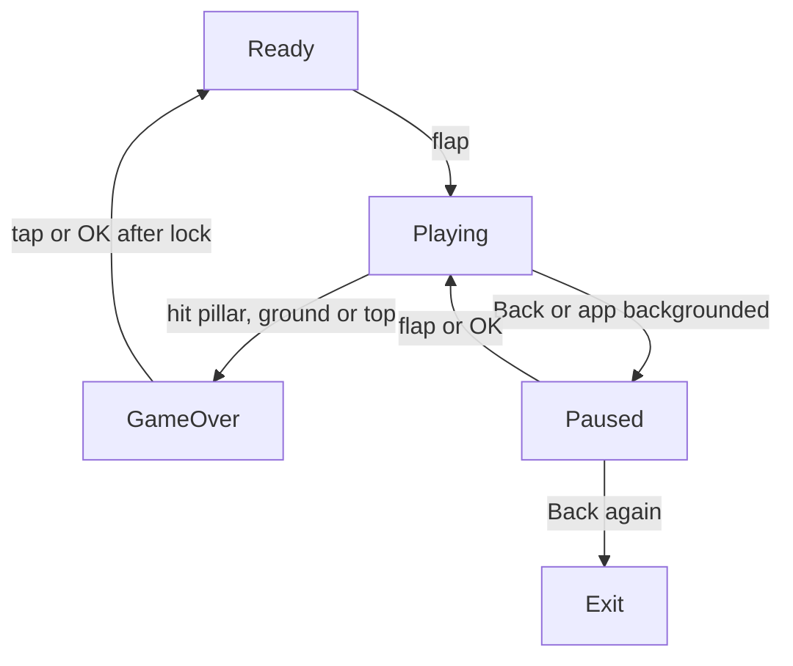
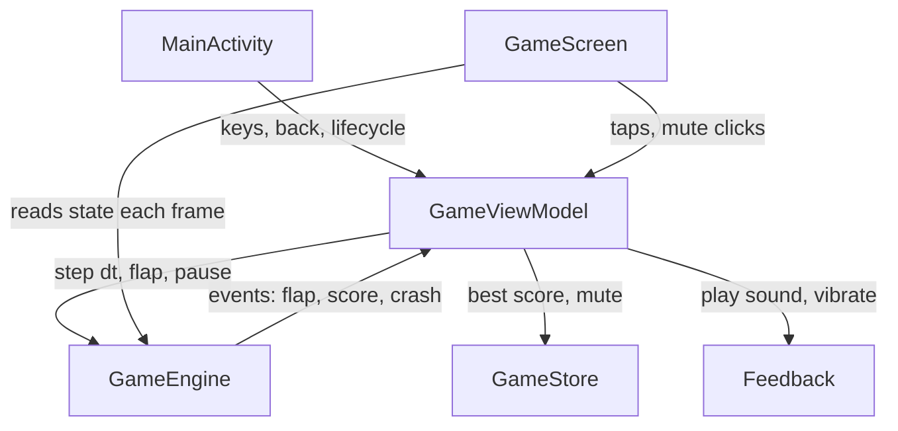
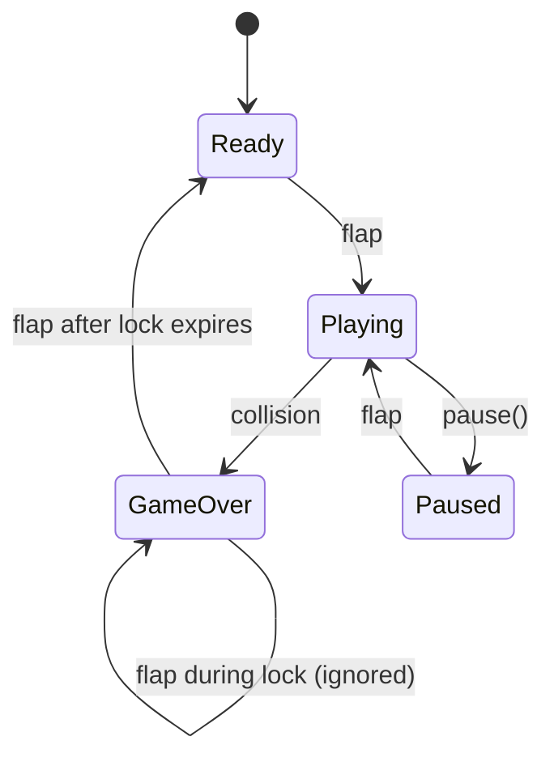

# Paper Glide Game - Plan

## Goal Capsule

- **Objective:** A person on an Android phone or an Android TV can start an original one-button glide game with no instructions, play a full round, see a score and medal, and retry at once to beat their best.
- **Means:** One native Kotlin + Jetpack Compose app with a pure-Kotlin game engine drawn on a Compose canvas (KTD1, KTD2).
- **Product authority:** The Product Contract below. "Paper Glide" is a working name. The game is original in genre only: it must not reuse Flappy Bird's name, bird character, green pipes, art, sounds or look.
- **Authority order:** Product Contract Requirements win on behavior. KTDs win on mechanism within those Requirements. Units override neither.
- **Stop conditions:** Stop and report if a Requirement cannot be met with the chosen stack, or if the build cannot resolve dependencies from the network.
- **Execution profile:** Greenfield single-module Android app in an empty repo; no existing code to preserve.
- **Open blockers:** None.

---

## Product Contract

Product Contract preservation: Product Contract unchanged.

### Summary

Paper Glide is a one-button side-scroller: a folded paper plane glides through gaps between cloud pillars, and each tap or remote press gives it a lift.
It ships as one native Android app that runs on phones (touch, portrait) and Android TV (remote or gamepad, landscape) with the same game loop.
Difficulty rises with score, the game-over screen awards a medal, and sound and haptics give feedback.

### Problem Frame

The user wants a casual game they can play both in hand and from the couch, with zero onboarding.
The value is the replay loop: a short round, an instant retry, and a best score to beat.
Phone and TV differ in input (touch vs D-pad remote) and screen shape (portrait vs landscape), so a game built for one tends to feel broken on the other.

### Key Decisions

- **Android only, one app for phone and TV.** One codebase and one store listing cover both form factors. Governs R1, R2. (session-settled: user-directed — chosen over Android + iPhone and over a web PWA: simplest path to both targets)
- **Original paper-plane-in-sky theme.** A flat pastel paper plane and cloud pillars, drawn as vector shapes so it stays sharp on a 4K TV. (session-settled: user-directed — chosen over jetpack robot, fish and bee themes: reads well from across a room)
- **Native Kotlin with Jetpack Compose, no game engine, no image assets.** The game is small enough that a frame loop and canvas drawing cover it. (session-settled: user-approved — chosen over libGDX/Godot engines: small game, sharp on 4K)
- **Scale the world by height.** Plane and gap size stay the same relative to screen height. TV landscape shows more pillars ahead, so TV is slightly easier; this is accepted. Governs R3. (session-settled: user-approved — chosen over width-based or letterboxed scaling: same feel on any screen)
- **Local-only, no monetisation.** No accounts, online leaderboards, ads or purchases. Governs R12. (session-settled: user-approved — chosen over online features: out of scope for v1)
- **Tune thresholds by playtest.** The medal and difficulty numbers in R9 and R11 are starting values, not locked. Governs R9, R11. (session-settled: user-approved — chosen over locking numbers now: tune by playtest)

### Requirements

**Platform and layout**

- R1. The app installs and launches from both the phone launcher and the Android TV home screen, including a TV banner.
- R2. The app needs no touchscreen to be fully playable on TV, and every menu works with the D-pad alone.
- R3. Phone plays in portrait and TV plays in landscape; the world scales by screen height so gameplay feels the same on any screen size.

**Core loop**

- R4. A round starts from a Ready screen with the plane hovering; the first flap input starts play.
- R5. Each flap gives the plane an upward lift; between flaps gravity pulls it down.
- R6. Cloud pillars scroll in from the right with a vertical gap at a random height, and passing a gap scores +1.
- R7. Hitting a pillar, the ground or the top edge ends the round.
- R8. Flap input is a touch anywhere on phone, and OK/Center, D-pad Up or gamepad A on TV.

**Difficulty**

- R9. Gap height narrows and scroll speed rises gradually with score, and both stop changing at about score 60.

**Game over and progression**

- R10. The game-over screen shows this round's score, the best score, and a "new best" marker when it was beaten.
- R11. The game-over screen awards a bronze medal at score 10, silver at 25 and gold at 50.
- R12. The best score persists on the device across app restarts.
- R13. Restart from game over takes one input (tap or OK) and returns to the Ready screen; a short input lock stops an accidental flap from skipping the screen.

**Feedback**

- R14. Flap, score and crash each play a distinct original sound effect.
- R15. On phone, a crash triggers a short vibration.
- R16. A mute toggle, reachable by touch and by D-pad, silences all sound and persists across restarts.

**Pause and lifecycle**

- R17. Play pauses when the app goes to the background, and on TV when Back is pressed; a second Back from pause exits the game.
- R18. The game never resumes play by itself; resuming waits for a player input.

### Key Flows



- F1. One round
  - **Trigger:** Player launches the app or restarts from game over.
  - **Steps:** Ready screen; first flap starts play; player flaps through gaps, scoring per gap; collision ends the round; game-over screen shows score, best and medal; one input returns to Ready.
  - **Covered by:** R4, R5, R6, R7, R10, R11, R13
- F2. Interrupt
  - **Trigger:** Back pressed on TV, or app sent to background on either device.
  - **Steps:** Play freezes; pause screen shows; flap/OK resumes; a second Back exits.
  - **Covered by:** R17, R18

### Acceptance Examples

- AE1. **Covers R11, R10.** Given a best score of 30, when a round ends at 27, then the screen shows score 27, best 30, a silver medal, and no "new best" marker.
- AE2. **Covers R10, R12.** Given a best score of 12, when a round ends at 14, then "new best" shows, and after closing and reopening the app the best score is 14.
- AE3. **Covers R11.** When a round ends at 9, then no medal is shown.
- AE4. **Covers R17, R18.** Given a TV round in progress, when the player presses Back, then play freezes on a pause screen; when they press Back again, the app exits.
- AE5. **Covers R17, R18.** Given a phone round in progress, when a call arrives and the app backgrounds, then on return the game shows the pause screen and waits for a tap.
- AE6. **Covers R13.** Given the plane just crashed while the player was tapping rapidly, when taps land in the first moment of game over, then the game-over screen stays visible.
- AE7. **Covers R16.** Given mute is on, when the app restarts, then mute is still on and no sound plays.

### Scope Boundaries

**Deferred for later**

- Extra characters, skins, or day/night themes.
- Local multiplayer.
- Play Store release work: signing, store listing, screenshots.
- A difficulty or settings menu beyond the mute toggle.

**Outside this product's identity**

- iOS and web builds.
- Accounts, online leaderboards, ads and in-app purchases.
- Any reuse of Flappy Bird's name, character, pipes, art or sounds.

**Considered and not built**

- Background music. Not requested; R14 covers effects only. Add if playtesting finds rounds feel empty.
- Release signing config and R8 minification. Release work is deferred above; a debug build proves the Requirements.

### Success Criteria

- A new player on either device starts playing within a few seconds without reading anything.
- Play feels smooth on a mid-range phone and on a typical Android TV box, with no visible stutter during a round.
- On TV, every screen is fully usable from a standard remote held at couch distance, with text readable from there.

### Outstanding Questions

**Deferred to Planning**

- Minimum API level and verification hardware: resolved by KTD9 and the Verification Contract.
- Sound production method: resolved by KTD7.
- Exact lift, gravity and speed constants: deferred to implementation; start from the values in U2 and tune by playtest.

---

## Planning Contract

### Key Technical Decisions

- KTD1. **Pure-Kotlin engine separate from rendering.** All game rules (physics, pillar spawning, scoring, collision, difficulty, medals, state machine, input lock) live in plain Kotlin classes with no Android imports, advanced by a `step(dt)` call and an injectable random source. This makes every rule in R4–R13 and R17–R18 unit-testable on the JVM without an emulator.
- KTD2. **Compose canvas with a `withFrameNanos` loop.** A single full-screen Compose canvas draws the world each frame from engine state; the loop clamps each frame's delta (about 1/30 s max) so a hitch or resume never tunnels the plane through a pillar. Instantiates the no-engine Key Decision. (session-settled: user-approved — chosen over libGDX/Godot engines: small game, sharp on 4K)
- KTD3. **Height-normalised world units.** World height is 1.0; horizontal extent is the screen aspect ratio; the renderer multiplies by pixel height. Pillars spawn just beyond the right edge of whatever width is visible. Governs R3. (session-settled: user-approved — chosen over width-based or letterboxed scaling: same feel on any screen)
- KTD4. **Activity-level key handling for TV.** Flap keys (`DPAD_CENTER`, `ENTER`, `DPAD_UP`, `BUTTON_A`, `SPACE`) are mapped in one pure function and dispatched from the activity, so focus quirks in Compose cannot swallow them. Back goes through an `OnBackPressedCallback` driven by game state. Overlay buttons (mute) stay focusable for D-pad navigation per R2.
- KTD5. **One activity, orientation chosen at runtime.** The manifest leaves orientation unspecified; on start the activity locks portrait unless `UiModeManager` reports television mode, where landscape is native. A per-device manifest value is impossible with one APK.
- KTD6. **Phone + TV in one manifest.** Declare `android.hardware.touchscreen` and `android.software.leanback` as not required, add a `LEANBACK_LAUNCHER` category beside `LAUNCHER`, and set an `android:banner` drawable. This is what puts one APK on both launchers per R1, R2.
- KTD7. **Sound effects synthesised in code.** Flap, score and crash are short tones generated as PCM buffers at startup and played through static `AudioTrack`s. They are original by construction, need no asset files, and cost a few KB of memory. Resolves the sound-production open question.
- KTD8. **SharedPreferences store for best score and mute.** Mirrors the sibling project's `GameStore` pattern; two keys, read once at start, written on change.
- KTD9. **Toolchain pinned to the sibling project's known-good set.** AGP 9.3.2 with built-in Kotlin and the Compose compiler plugin 2.4.10, Compose BOM 2026.09.00, Gradle wrapper 9.7.1 (cached locally), JDK 21 toolchain, `compileSdk` 37, `targetSdk` 36, `minSdk` 24. Every Android TV device on API 24+ is covered and all SDK platforms are installed.
- KTD10. **ViewModel owns the engine and frame-independent state.** A `GameViewModel` holds the engine, store and audio references so a configuration change does not reset a round. Lifecycle `ON_PAUSE` forces Playing to Paused per R17; it fires for backgrounding, incoming-call screens and multi-window loss of focus, so the plane never flies unseen.

### High-Level Technical Design

Component shape:



Engine state machine (the product flow in F1/F2 plus the input lock from R13):



Directional step sketch, not an implementation specification:

```text
step(dt):
  if state != Playing: animate hover/idle only; tick game-over lock; return
  velocity += gravity * dt; y += velocity * dt
  scroll pillars left by speed(score) * dt; spawn new pillar when last one clears spacing
  for pillar passed by plane x: score += 1; emit Score
  if hits(pillar) or y <= 0 or y >= groundTop: state = GameOver; emit Crash; start lock
```

### Assumptions

- Package and application ID `com.paperglide`; app label "Paper Glide".
- Starting physics constants (world units per second): gravity about 2.6, flap velocity about -0.9, start speed about 0.45 rising to about 0.65, start gap about 0.32 of height narrowing to about 0.24. Tuned by playtest per the Key Decision.
- Game-over input lock about 600 ms (R13).
- Plane hitbox is a circle slightly smaller than the drawn plane, so near-misses feel fair.
- Back on Ready or GameOver exits the app (system default); R17 only defines Back during play and pause.
- TV text sizes scale from screen height, which keeps HUD text readable at couch distance without a separate TV layout.

### Output Structure

```text
settings.gradle.kts
build.gradle.kts
gradle.properties
gradle/libs.versions.toml
gradle/wrapper/gradle-wrapper.properties
gradle/wrapper/gradle-wrapper.jar
gradlew, gradlew.bat
app/build.gradle.kts
app/src/main/AndroidManifest.xml
app/src/main/res/                         launcher icon, TV banner (vector), strings, theme
app/src/main/java/com/paperglide/
  MainActivity.kt
  GameViewModel.kt
  GameStore.kt
  Feedback.kt                             synthesised sounds + vibration
  input/KeyMapping.kt
  game/GameEngine.kt                      state machine, physics, scoring, collision
  game/Difficulty.kt                      gap/speed curves, medal thresholds
  ui/GameScreen.kt                        canvas + overlays
  ui/Drawing.kt                           plane, clouds, sky shapes
app/src/test/java/com/paperglide/
  game/GameEngineTest.kt
  game/DifficultyTest.kt
  input/KeyMappingTest.kt
  GameStoreTest.kt
  FeedbackTest.kt
  ManifestTest.kt
  ui/GameFlowTest.kt
```

### Risks

- **No TV system image is installed.** Robolectric tests with the `television` qualifier cover TV logic; a real TV emulator run needs an Android TV system image download. Treat the emulator run as best-effort verification.
- **Vector drawable as TV banner.** Some older TV launchers handle vector banners poorly. If the banner renders blank on an emulator, fall back to a generated PNG at `drawable-xhdpi`.
- **Frame pacing on low-end TV boxes.** Canvas drawing of a few dozen shapes is cheap, but allocations per frame cause GC stutter; drawing must reuse paths and avoid per-frame object creation.

---

## Implementation Units

### U1. Project scaffold, manifest and launch on phone + TV

**Goal:** An empty-but-launchable Compose app that both the phone launcher and the Android TV launcher list.

**Requirements:** R1, R2, R3; KTD5, KTD6, KTD9.

**Dependencies:** None.

**Files:**
- Create: `settings.gradle.kts`, `build.gradle.kts`, `gradle.properties`, `gradle/libs.versions.toml`, `gradle/wrapper/gradle-wrapper.properties`, `gradle/wrapper/gradle-wrapper.jar`, `gradlew`, `gradlew.bat`, `.gitignore`
- Create: `app/build.gradle.kts`, `app/src/main/AndroidManifest.xml`, `app/src/main/java/com/paperglide/MainActivity.kt`
- Create: `app/src/main/res/values/strings.xml`, `app/src/main/res/values/themes.xml`, `app/src/main/res/drawable/ic_launcher_foreground.xml`, `app/src/main/res/drawable/tv_banner.xml`, `app/src/main/res/mipmap-anydpi-v26/ic_launcher.xml`
- Test: `app/src/test/java/com/paperglide/ManifestTest.kt`

**Approach:**
1. Copy the Gradle wrapper jar and scripts from the sibling project pattern and point the distribution at Gradle 9.7.1.
2. Version catalog and app build file follow the sibling project's set (KTD9), including Robolectric test options.
3. Manifest per KTD6; activity is fullscreen, `configChanges` covers orientation/screen size so the round is not recreated needlessly.
4. Activity applies the runtime orientation rule (KTD5) and hides system bars for immersive play.
5. Launcher icon and TV banner are original vector art: a pastel paper plane on sky blue, banner adds the "Paper Glide" wordmark.

**Patterns to follow:** sibling project `sudokuhijaiyah` build files (`settings.gradle.kts`, `app/build.gradle.kts`, `gradle/libs.versions.toml`).

**Test scenarios:**
- The package manager resolves an activity for `ACTION_MAIN` + `CATEGORY_LAUNCHER`.
- The package manager resolves an activity for `ACTION_MAIN` + `CATEGORY_LEANBACK_LAUNCHER`.
- Application info carries a non-zero banner resource.
- Under the `television` qualifier, the activity does not request portrait; under a phone configuration it requests portrait.

**Verification:** A debug APK builds, and the manifest tests pass.

### U2. Game engine: state machine, physics, pillars, scoring, collision, difficulty, medals

**Goal:** Every gameplay rule exists as pure Kotlin and is proven by JVM unit tests.

**Requirements:** R4, R5, R6, R7, R9, R11, R13, R17 (pause entry), R18; F1, F2; AE1, AE3, AE6; KTD1, KTD3; Key Decision on tunable thresholds (governs R9, R11).

**Dependencies:** U1 (build only).

**Files:**
- Create: `app/src/main/java/com/paperglide/game/GameEngine.kt`, `app/src/main/java/com/paperglide/game/Difficulty.kt`
- Test: `app/src/test/java/com/paperglide/game/GameEngineTest.kt`, `app/src/test/java/com/paperglide/game/DifficultyTest.kt`

**Approach:**
1. States Ready, Playing, Paused, GameOver as in the HTD state diagram; `flap()`, `pause()`, `step(dt)` and a visible-width setter are the only inputs.
2. Engine emits one-shot events (Flap, Score, Crash) that the ViewModel drains each frame for feedback.
3. Difficulty curves interpolate from start values to plateau values by `min(score, 60) / 60` (R9); medal thresholds 10/25/50 live as named constants in one place (R11).
4. Pillar gap centre is drawn from an injected random source within safe margins so a gap never touches the ground or top.
5. The game-over lock is a countdown ticked by `step`, so tests advance it deterministically.
6. Constants start from the Assumptions values.

**Execution note:** Implement test-first; the engine has no UI dependency, so each rule can be driven by a failing test before code.

**Test scenarios:**
- Ready: `step` for 2 s leaves the plane at its hover height band and score 0.
- Ready + `flap()` moves to Playing with upward velocity.
- Playing with no flaps: the plane falls and hits the ground, state becomes GameOver, and a Crash event fires once.
- Playing: flying above the top edge ends the round (R7).
- A plane centred in a gap passes the pillar and score goes 0→1 with exactly one Score event; it does not score twice for the same pillar.
- A plane overlapping a pillar body ends the round.
- With a seeded random source, gap centres always keep the full gap inside the playfield.
- A wider visible width (TV aspect) spawns pillars further right but with the same spacing and gap size (KTD3).
- Covers AE6. GameOver + `flap()` before the lock expires stays in GameOver; after the lock expires it moves to Ready with score reset.
- `pause()` from Playing moves to Paused; `step` while Paused changes no positions; `flap()` resumes Playing (R18).
- `pause()` from Ready or GameOver changes nothing.
- `step` with an oversized dt is clamped so the plane cannot skip through a pillar.
- Difficulty: gap at score 0 equals the start value, at 60 equals the plateau, at 200 still equals the plateau, and is non-increasing between them; speed mirrors this rising.
- Covers AE3. Medal for 9 is none.
- Covers AE1. Medal for 27 is silver; boundaries 10→bronze, 25→silver, 50→gold, 49→silver.

**Verification:** All engine and difficulty tests pass on the JVM.

### U3. Persistent best score and mute

**Goal:** Best score and mute survive app restarts.

**Requirements:** R10 (new-best detection), R12, R16; AE2, AE7; KTD8.

**Dependencies:** U1.

**Files:**
- Create: `app/src/main/java/com/paperglide/GameStore.kt`
- Test: `app/src/test/java/com/paperglide/GameStoreTest.kt`

**Approach:** Two keys in one private SharedPreferences file. Recording a finished round returns whether it beat the stored best, and only writes when it did.

**Patterns to follow:** `sudokuhijaiyah` `GameStore` (SharedPreferences with `edit {}`).

**Test scenarios:**
- Fresh install: best is 0 and mute is off.
- Covers AE2. Best 12, record 14: returns new-best true; a new store instance over the same context reads 14.
- Best 30, record 27: returns false and best stays 30.
- Record equal to best: not a new best.
- Covers AE7. Set mute on; a new store instance reads mute on.

**Verification:** Store tests pass under Robolectric.

### U4. Game screen: canvas rendering, frame loop, overlays, ViewModel wiring

**Goal:** The engine is visible and playable by touch, with Ready, Pause and Game-over overlays.

**Requirements:** R3, R4, R6, R8 (touch), R10, R11, R13, R16 (touch toggle); F1; AE1; KTD2, KTD3, KTD10.

**Dependencies:** U2, U3.

**Files:**
- Create: `app/src/main/java/com/paperglide/GameViewModel.kt`, `app/src/main/java/com/paperglide/ui/GameScreen.kt`, `app/src/main/java/com/paperglide/ui/Drawing.kt`
- Modify: `app/src/main/java/com/paperglide/MainActivity.kt`
- Test: `app/src/test/java/com/paperglide/ui/GameFlowTest.kt`

**Approach:**
1. ViewModel owns engine and store (KTD10), exposes a frame-tick entry point, records the round on GameOver, and holds `newBest` for the overlay.
2. Screen runs the `withFrameNanos` loop (KTD2) and passes the canvas aspect ratio to the engine as visible width.
3. Drawing: sky gradient, soft distant clouds, cloud pillars as rounded stacked puffs, the plane as a folded triangle pair tilted by velocity, a ground strip. Paths are built once and reused; no per-frame allocation (Risks).
4. HUD shows the live score at top centre with text sized from screen height.
5. Overlays: Ready ("Tap or press OK to fly"), Paused, and Game-over card with score, best, new-best badge and medal drawn as a coloured disc with a text label so colour is not the only signal.
6. Mute button sits in a top corner, is at least 48 dp, and is keyboard-focusable; it carries a content description.
7. A tap anywhere outside the mute button counts as flap.

**Execution note:** Rendering is mostly visual; prove behaviour through the ViewModel and a Compose UI flow test, and check look by running the app.

**Test scenarios:**
- Ready overlay is shown on launch with the start hint text.
- A tap on the screen hides the Ready overlay (Playing).
- Driving the ViewModel until a crash shows the game-over card with score and best.
- Covers AE1. With stored best 30 and a round ending at 27, the card shows 27, 30, a silver medal label, and no new-best badge.
- A tap during the input lock leaves the card visible; a tap after it shows Ready.
- Tapping the mute button toggles its state and does not flap.

**Verification:** UI flow tests pass; the app runs on the phone emulator and a round is playable start to finish.

### U5. TV input, back handling, orientation and lifecycle pause

**Goal:** The game is fully playable with a remote or gamepad, and pause/exit behave per R17.

**Requirements:** R2, R8 (keys), R17, R18; F2; AE4, AE5; KTD4, KTD5, KTD10.

**Dependencies:** U4.

**Files:**
- Create: `app/src/main/java/com/paperglide/input/KeyMapping.kt`
- Modify: `app/src/main/java/com/paperglide/MainActivity.kt`, `app/src/main/java/com/paperglide/GameViewModel.kt`, `app/src/main/java/com/paperglide/ui/GameScreen.kt`
- Test: `app/src/test/java/com/paperglide/input/KeyMappingTest.kt`, `app/src/test/java/com/paperglide/ui/GameFlowTest.kt`

**Approach:**
1. Pure key-to-action mapping (KTD4); key-down only, repeats ignored so holding OK does not machine-gun flaps.
2. When focus is on the mute button, OK activates mute instead of flap; D-pad Up still flaps, D-pad Down/Left/Right move focus.
3. Back callback is enabled only while Playing or Paused: Playing → pause, Paused → finish.
4. Lifecycle `ON_PAUSE` pauses a Playing round (AE5, KTD10); nothing auto-resumes (R18).

**Test scenarios:**
- `DPAD_CENTER`, `ENTER`, `DPAD_UP`, `BUTTON_A`, `SPACE` key-down map to flap.
- A repeated key-down (repeat count > 0) maps to nothing.
- Other keys (volume, `DPAD_LEFT`) map to nothing.
- Covers AE4. Under the `television` qualifier: start a round with OK, press Back → Paused overlay; press Back again → activity finishing.
- From Paused, OK resumes Playing, and on phone a tap resumes Playing.
- Covers AE5. Moving the activity to paused while Playing and back to resumed shows Paused, and the plane has not moved.
- Back on Ready lets the activity finish (default behaviour).
- D-pad focus can reach the mute button and OK toggles it.

**Verification:** Key and flow tests pass; on any available emulator, a hardware keyboard Enter/Up plays a full round without touch.

### U6. Synthesised sounds, crash vibration and mute

**Goal:** Flap, score and crash are audible and distinct; crash vibrates on phones; mute silences everything.

**Requirements:** R14, R15, R16; AE7; KTD7.

**Dependencies:** U3, U4.

**Files:**
- Create: `app/src/main/java/com/paperglide/Feedback.kt`
- Modify: `app/src/main/java/com/paperglide/GameViewModel.kt`, `app/src/main/AndroidManifest.xml` (`VIBRATE` permission)
- Test: `app/src/test/java/com/paperglide/FeedbackTest.kt`

**Approach:**
1. Generate three short mono 16-bit PCM buffers once: a soft rising whoosh for flap, a bright two-note chime for score, a low falling thud with noise for crash. Each has a short attack/decay envelope to avoid clicks.
2. Play through static `AudioTrack`s with game usage attributes; replay restarts from the beginning.
3. Vibration uses the system vibrator only when one exists, a single ~60 ms pulse on crash; TV boxes without one are a no-op.
4. Feedback is released with the ViewModel.
5. The ViewModel drains engine events each frame and calls feedback, skipping sound when muted.

**Test scenarios:**
- Each generated buffer is non-empty, under 0.5 s long, and starts and ends near zero amplitude.
- The three buffers differ from each other.
- With mute on, a crash event triggers no sound play call but still vibrates on a device with a vibrator.
- On a device with no vibrator, a crash does not throw.

**Verification:** Feedback tests pass; on the emulator the three sounds are audible and distinct, and mute silences them.

---

## Verification Contract

| Gate | Command | Proves |
|---|---|---|
| Unit + Robolectric tests | `./gradlew testDebugUnitTest` | U1–U6 test scenarios, including TV-qualifier tests |
| Build | `./gradlew assembleDebug` | App compiles and packages as one APK |
| Lint | `./gradlew lintDebug` | No new errors, including TV-manifest lint checks (missing banner, touchscreen required) |
| Phone smoke | Install the debug APK on the `Medium_Phone_API_28` AVD and play one full round | F1 on a real runtime, portrait lock |
| TV smoke (best-effort) | Install on an Android TV emulator if a TV system image is available | Leanback launcher listing, remote play, Back behaviour |

## Definition of Done

- Every unit's test scenarios exist and pass, and all gates in the Verification Contract that are runnable here pass.
- R1–R18 each map to at least one passing test or a recorded manual smoke result.
- No asset, name or text references Flappy Bird.
- No dead-end or experimental code from abandoned attempts remains in the diff.
- Any gate that could not run (for example the TV emulator) is stated in the hand-off with the reason.
